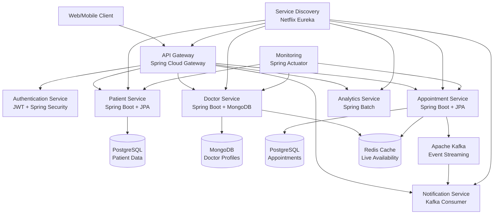

# 🏥 OPD Heal - Microservices Architecture

<div align="center">


**A comprehensive, scalable microservices-based OPD management system built with modern enterprise technologies**

[Features](#-key-features) • [Architecture](#-system-architecture) • [Tech Stack](#-tech-stack) • [Quick Start](#-quick-start) • [API Documentation](#-api-documentation)

</div>

---

## 🌟 Project Overview

This OPD Heal system is designed as a **production-ready microservices architecture** that demonstrates enterprise-level software engineering practices. The system handles patient registration, doctor management, appointment scheduling, real-time notifications, and comprehensive analytics - all while maintaining high availability, scalability, and security.

### 🎯 Why This Project Stands Out

- **Real-time Operations**: Live doctor availability tracking with Redis caching
- **Event-Driven Architecture**: Asynchronous communication using Apache Kafka
- **Enterprise Security**: JWT-based authentication with role-based access control
- **High Performance**: Optimized with caching strategies and efficient data access patterns
- **Production Ready**: Comprehensive monitoring, health checks, and containerized deployment
- **Scalable Design**: Independent microservices that can scale horizontally

---

## 🚀 Key Features

### 🔥 **Advanced Features**

| Feature | Description | Technology |
|---------|-------------|------------|
| **🟢 Live Doctor Availability** | Real-time tracking of doctor consultation status with auto-refresh | Redis + Spring Cache |
| **📱 Smart Notifications** | Event-driven SMS/Email notifications for appointments | Apache Kafka + Spring Events |
| **🔐 Role-Based Security** | Multi-tier access control (Patient/Doctor/Admin) | Spring Security + JWT |
| **📊 Dynamic Slot Management** | Flexible doctor availability with custom scheduling | Spring Data JPA |
| **📈 Analytics Dashboard** | Real-time insights on appointments, cancellations, peak hours | Spring Batch + Scheduler |
| **⚡ Performance Monitoring** | Health checks, metrics, and system monitoring | Spring Actuator + Prometheus |

### 💼 **Core Functionalities**

- **Patient Management**: Registration, profile management, medical history
- **Doctor Management**: Profile setup, availability management, patient queue
- **Appointment System**: Booking, rescheduling, cancellations with real-time updates
- **Medical Records**: Patient history, diagnoses, prescription management
- **Notification System**: Automated reminders and confirmations
- **Reporting & Analytics**: Comprehensive insights and business intelligence

---

## 🏗️ System Architecture



### 🎯 **Microservices Architecture Benefits**

- **Independent Deployment**: Each service can be deployed independently
- **Technology Diversity**: Different databases for different use cases
- **Fault Tolerance**: Service isolation prevents cascading failures
- **Scalability**: Scale services based on individual load requirements
- **Team Autonomy**: Different teams can work on different services

---

## 🛠️ Tech Stack

### 🔧 **Backend & Core Framework**
```yaml
Language: Java 17 (LTS)
Framework: Spring Boot 3.2+
Architecture: Microservices with Spring Cloud
Service Discovery: Netflix Eureka
API Gateway: Spring Cloud Gateway
Data Access: Spring Data JPA, Spring Data MongoDB
Validation: Spring Boot Validation
Security: Spring Security + JWT
```

### 📡 **Communication & Messaging**
```yaml
Synchronous: OpenFeign Client (HTTP)
Asynchronous: Apache Kafka (Event Streaming)
Message Format: JSON, Avro (for Kafka)
Protocol: REST APIs, Event-Driven Messaging
```

### 🗄️ **Data & Caching**
```yaml
Primary Database: PostgreSQL (ACID compliance)
Document Store: MongoDB (Flexible schemas)
Caching Layer: Redis (Session, availability cache)
Connection Pooling: HikariCP
Migration: Flyway Database Migration
```

### 🔧 **DevOps & Infrastructure**
```yaml
Containerization: Docker + Docker Compose
Service Mesh: Istio (Future roadmap)
Monitoring: Spring Boot Actuator, Prometheus
Documentation: Swagger/OpenAPI 3.0
Testing: JUnit 5, Testcontainers, MockMVC
Load Testing: Apache JMeter
```

### 📊 **Monitoring & Observability**
```yaml
Health Checks: Spring Boot Actuator
Metrics: Micrometer + Prometheus
Logging: SLF4J + Logback
Distributed Tracing: Spring Cloud Sleuth
Visualization: Grafana (Optional)
```

---

## 🚀 Quick Start

### Prerequisites
- **Java 17+** ☕
- **Docker & Docker Compose** 🐳
- **Maven 3.8+** 📦
- **Git** 🔧

### 🏃‍♂️ **Running the Application**

1. **Clone the repository**
   ```bash
   git clone https://github.com/yourusername/opd-heal-microservices.git
   cd opd-heal-microservices
   ```

2. **Start Infrastructure Services**
   ```bash
   # Start Redis, Kafka, Zookeeper, Databases
   docker-compose -f docker-compose.infrastructure.yml up -d
   ```

3. **Build and Run Services**
   ```bash
   # Build all services
   mvn clean install
   
   # Start services in order
   docker-compose up -d
   ```

4. **Verify Services**
   ```bash
   # Check service health
   curl http://localhost:8761  # Eureka Dashboard
   curl http://localhost:8080/actuator/health  # API Gateway Health
   ```

### 🌐 **Service Endpoints**

| Service | Port | Health Check | Documentation |
|---------|------|--------------|---------------|
| **API Gateway** | 8080 | `/actuator/health` | `/swagger-ui.html` |
| **Eureka Server** | 8761 | `/actuator/health` | `/` |
| **Patient Service** | 8081 | `/actuator/health` | `/swagger-ui.html` |
| **Doctor Service** | 8082 | `/actuator/health` | `/swagger-ui.html` |
| **Appointment Service** | 8083 | `/actuator/health` | `/swagger-ui.html` |
| **Notification Service** | 8084 | `/actuator/health` | `/swagger-ui.html` |
| **Analytics Service** | 8085 | `/actuator/health` | `/swagger-ui.html` |

---

## 📚 API Documentation

### 🔐 **Authentication**
```http
POST /auth/login
Content-Type: application/json

{
  "username": "doctor@hospital.com",
  "password": "securePassword123"
}
```

### 👤 **Patient Operations**
```http
# Register new patient
POST /api/patients/register

# Get patient profile
GET /api/patients/{patientId}

# Update medical history
PUT /api/patients/{patientId}/medical-history
```

### 👨‍⚕️ **Doctor Operations**
```http
# Get doctor availability
GET /api/doctors/{doctorId}/availability

# Update availability slots
PUT /api/doctors/{doctorId}/slots

# Get patient queue
GET /api/doctors/{doctorId}/queue
```

### 📅 **Appointment Management**
```http
# Book appointment
POST /api/appointments/book

# Get real-time availability
GET /api/appointments/availability?doctorId={id}&date={date}

# Cancel appointment
DELETE /api/appointments/{appointmentId}
```

### 🔔 **Real-time Features**
- **WebSocket**: `/ws/doctor-availability` - Live doctor status updates
- **Server-Sent Events**: `/api/notifications/stream` - Real-time notifications
- **Kafka Topics**: `appointment-booked`, `appointment-cancelled`, `doctor-availability-changed`

---

## 🏢 Business Logic & Workflows

### 📋 **Appointment Booking Flow**
1. **Patient** searches for available doctors
2. **System** checks Redis cache for real-time availability
3. **Patient** selects time slot and books appointment
4. **Appointment Service** validates and saves booking
5. **Kafka Event** triggers notification to patient and doctor
6. **Redis Cache** updates doctor availability instantly
7. **Analytics Service** records booking metrics

### 🔄 **Event-Driven Architecture**
- **Appointment Booked** → Email/SMS confirmation + Calendar update
- **Doctor Availability Changed** → Cache update + Patient notifications
- **Appointment Reminder** → Scheduled notification 15 minutes before
- **No-Show Detected** → Analytics update + Doctor notification

---

## 📊 Monitoring & Analytics

### 🎯 **Key Metrics Tracked**
- **Performance**: Response times, throughput, error rates
- **Business**: Appointment bookings, cancellations, no-shows
- **System**: Memory usage, CPU utilization, database connections
- **User Experience**: Page load times, API response times

### 📈 **Health Monitoring**
```bash
# Service health endpoints
curl http://localhost:8080/actuator/health
curl http://localhost:8080/actuator/metrics
curl http://localhost:8080/actuator/prometheus
```

---

## 🔧 Development & Testing

### 🧪 **Testing Strategy**
```bash
# Unit tests
mvn test

# Integration tests with Testcontainers
mvn verify -P integration-tests

# Load testing
./scripts/load-test.sh
```

### 🐳 **Docker Development**
```bash
# Build custom Docker images
docker build -t hospital-patient-service ./patient-service

# Run specific service
docker run -p 8081:8081 hospital-patient-service
```

---

## 🚀 Future Roadmap

- [ ] **Mobile App Integration** (React Native/Flutter)
- [ ] **AI-Powered Scheduling** (ML-based optimal slot recommendations)
- [ ] **Telemedicine Support** (Video consultation integration)
- [ ] **IoT Integration** (Medical device data streaming)
- [ ] **Blockchain** (Secure medical record sharing)
- [ ] **GraphQL API** (Efficient data fetching)
- [ ] **Service Mesh** (Istio for advanced traffic management)

---

## 🤝 Contributing

We welcome contributions! Please see our [Contributing Guidelines](CONTRIBUTING.md) for details.

1. Fork the repository
2. Create a feature branch (`git checkout -b feature/amazing-feature`)
3. Commit your changes (`git commit -m 'Add amazing feature'`)
4. Push to the branch (`git push origin feature/amazing-feature`)
5. Open a Pull Request

---

## 📝 License

This project is licensed under the MIT License - see the [LICENSE](LICENSE) file for details.

---

## 📞 Contact & Support

<!-- - **GitHub Issues**: [Report bugs or request features](https://github.com/yourusername/opd-heal-microservices/issues)
- **Discussions**: [Join the community](https://github.com/yourusername/opd-heal-microservices/discussions) -->
- **Email**: contact.shindemahesh2112@gmail.com

---

<div align="center">

**⭐ Star this repository if you find it helpful!**

Made with ❤️ and ☕ by Mahesh Shinde

</div>